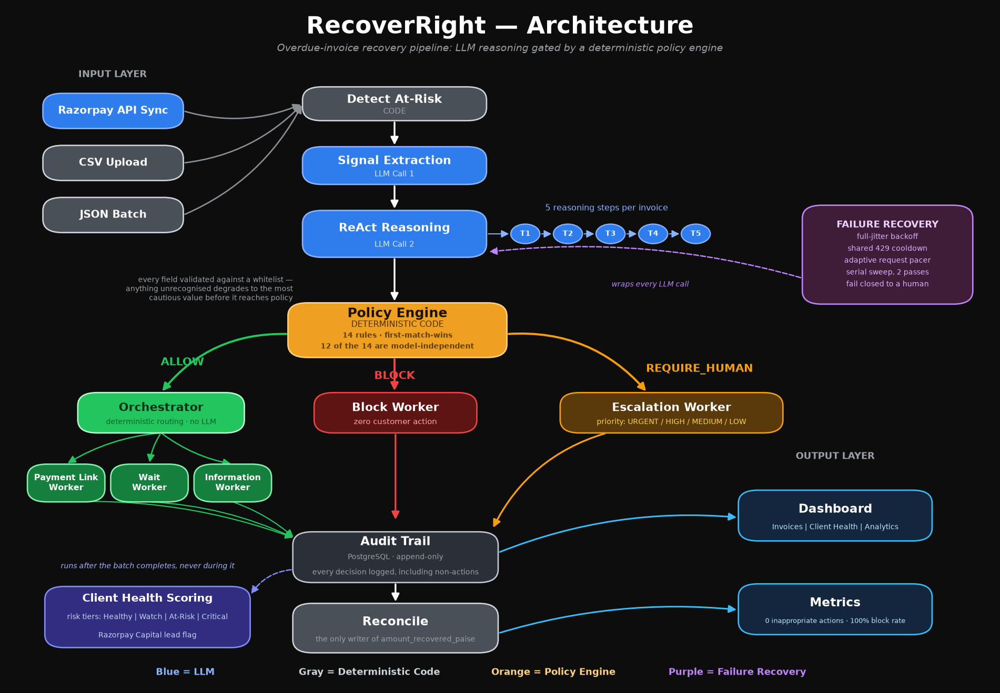

# RecoverRight

**Evidence-Honest B2B Receivables Recovery**

> "RecoverRight identifies why an overdue invoice is unpaid, recommends the least-risky recovery action, and executes it only when a deterministic policy engine permits it."

Built for the **Razorpay AI Buildathon — Track 03: AI Revenue Recovery**

---

**What it is.** An autonomous agent for overdue B2B invoices. It diagnoses *why*
each invoice is unpaid, proposes the least-risky recovery action, and executes
it only if a deterministic 14-rule policy engine permits — so a disputed invoice
is never chased, a legal threat never gets an automated reply, and a ₹50L
strategic account never gets collected on without a human. Every decision,
including every refusal, is on the audit trail.

**Demo video:** : https://www.youtube.com/watch?v=s-3B0S9CR_w

**60-second run** (no Razorpay account, no payments, no LLM spend):

```bash
git clone https://github.com/pranavv05/recoverright && cd recoverright
cp .env.example .env                  # add your free NVIDIA NIM key
docker compose up -d                  # Postgres
pip install -r requirements.txt
python -m pytest -m "not llm"         # 865 tests, no API keys or DB needed
python -m api.main                    # batch over 52 invoices, simulated
uvicorn api.main:app --port 8000      # then: cd frontend && npm i && npm run dev
```

**Headline results are from two runs against the current model.** The
original submission was benchmarked against `meta/llama-3.1-8b-instruct`,
which reached end-of-life on NVIDIA NIM on 2026-08-26 and now returns HTTP
410 for every call; it was replaced with `meta/llama-3.2-11b-vision-instruct`
(see § Tech Stack). Two runs of
`python -m evaluation.run --dataset data/held_out.json` against the current
model gave, respectively, `cause_accuracy: 0.439 / 0.463`,
`evidence_tier_accuracy: 0.439 / 0.439`, `action_accuracy: 0.39 / 0.39`,
`inappropriate_action_count: 0 / 0`, `correct_block_rate: 1.0 / 1.0`,
`correct_escalation_rate: 1.0 / 1.0`, `over_escalation_count: 5 / 5`. Accuracy
metrics vary run to run because diagnosis is a sampled LLM call at
temperature > 0; the safety metrics did not move at all.

| | |
|---|---|
| Inappropriate actions (ALLOW on an invoice needing a human) | **0** — both runs |
| Hard stops correctly blocked | **100%** (5/5) — both runs |
| Human-required invoices correctly escalated | **100%** — both runs |
| Cause diagnosis accuracy | 45.1% (mean of 2 runs) |
| Over-escalations (safe invoices refused) | 5 of 14 — both runs |

Those two halves are the point, and they belong together: the safety numbers
were **identical across both runs** — on the very runs where the model
got the cause wrong more than half the time. The engine holds while the model it
depends on is unreliable. Zero inappropriate actions is only meaningful next to
the over-escalation count, because an engine that escalated all 41 would also
score zero. See § Evaluation Results for the full accounting, including what
this system still gets wrong.

**And one output is revenue for Razorpay, not for the merchant.** Diagnosing
*why* an invoice is unpaid separates a client who won't pay from one who
currently can't — and the second group is a working-capital book. Across this
corpus the scorer flags **9 of 92 clients**, ₹23.85 lakh of receivables, as
Razorpay Capital candidates: payment history that was reliable and has recently
deteriorated, no disputes, no legal threats. Qualified leads produced as a
by-product of collections, with no form for anyone to fill in.
See § Razorpay Capital Lead Generation.

---

## The Problem

Every month, thousands of Indian businesses send out invoices and wait. Some get paid on time. Many don't. When businesses chase overdue invoices, they treat every single one the same way — one generic reminder, sent to everyone.

The disputed client gets chased — making the dispute worse. The strategic ₹50 lakh partner gets a collection message — damaging the relationship. The client with a broken payment link gets another useless reminder instead of a working link. The duplicate invoice gets chased — embarrassing the company.

The system doesn't just fail to recover money. When it gets the action wrong, it creates active damage.

Every business already has the data to do this right. The problem is that reasoning about 24 invoices with 24 different contexts — and making 24 different judgment calls — has always required a human analyst. Until now.

---

## The Solution

RecoverRight is an autonomous B2B receivables recovery agent that processes a batch of overdue invoices, diagnoses why each one is unpaid while staying honest about its confidence, routes every proposed action through a deterministic policy engine before acting, and reports honestly-measured, reconciled money recovered with a full audit trail.

**For each overdue invoice, it asks three questions before doing anything:**

1. **What do I actually know?** Not what seems likely — what is supported by evidence in the data. It labels every diagnosis as `Known`, `Strong Inference`, or `Unknown`. When it does not know, it says so instead of inventing a reason.

2. **What should I do about it?** A broken link needs a new link, not a reminder. A dispute needs a human, not a collection message. A chronic late-payer behaving normally needs nothing yet.

3. **Am I allowed to do it?** Every recommendation passes through a deterministic policy engine. Disputes block automated chasing, always. Legal threats block automated responses, always. High-value accounts require human approval, always.

> **The model can be wrong. The policy engine is the final authority.**

---

## Architecture



```
Batch of overdue invoices   (JSON dataset | CSV upload | Razorpay API sync)
        │
[CODE]  Detect at-risk           → filter not-yet-worth-acting-on
        │
        │   ┌─────────────── ReAct diagnosis: two sequential LLM calls ──────────────┐
[LLM]   │   Call 1 — Signal extraction   → observe only, never conclude: engagement,
        │                                  payment-history trend, content signal,
        │                                  willingness to pay, commitment, …
[LLM]   │   Call 2 — Reasoning chain     → Thought 1..5 in the open, THEN a cause +
        │                                  evidence tier (Known/Inference/Unknown) +
        │                                  cited evidence + a proposed action
        │   └───────────────────────────────────────────────────────────────────────┘
        │        every field validated against a whitelist; anything unrecognised
        │        degrades to the most cautious value before it reaches policy
        │
[CODE]  POLICY ENGINE            → ALLOW / BLOCK / REQUIRE_HUMAN
        │                          14 rules, first-match-wins, deterministic
        │
[CODE]  ORCHESTRATOR             → routes the decision to exactly one worker.
        │                          Deterministic table lookup, no LLM at this layer.
        │
   ┌────┴─────┬──────────┬──────────┬─────────────┐
PaymentLink Escalation  Block      Wait      Information
 (Razorpay)  (human,    (records   (schedules (drafts, never
     │        priorit-   refusal,   re-check)  sends)
     │        ised)      contacts
     │          │        nobody)
     │          ↓
     │  [HUMAN] REVIEW QUEUE  → approve / reject / defer. An approval may pick
     │                          only from the engine's own allowed_actions, so
     │                          it can never authorise a chase or a payment
     │                          demand. Every verdict is audited, by name.
     │
[CODE]  Reconcile                → triggered by a poll after link creation, or
        │                          by a signed payment_link.paid webhook. Either
        │                          way it re-reads Razorpay; recovery counts ONLY
        │                          on confirmed amount_paid (the only writer of
        │                          amount_recovered_paise). The webhook body's
        │                          own amount is never used.
        │
[CODE]  Audit trail              → every decision logged: wanted / allowed / did / result
        │
        ├─ [CODE] Client health scoring → per-client risk tier, from the batch's own
        │                                 diagnoses. Runs after the batch, never during.
        ├─ [CODE] Batch analytics       → recovery by scenario, rule frequency, cohorts
        └─ [CODE] Metrics               → honest recovery rate on ground-truthed held-out set
```

Reconciliation runs inline in `process_invoice`, immediately after every
successful `create_payment_link` — it is not a demo-only step. It has two
triggers: the inline poll after link creation, and the signed webhook at
`POST /api/webhooks/razorpay`. Both call the same `reconcile_payment`, which
re-reads the Razorpay API; the webhook's own reported amount is never written.
See § Razorpay Webhook.

### Key Design Decisions

**LLM proposes, code disposes.** The LLM never executes anything directly.
Every recommendation passes through the policy engine, which is deterministic
and testable, and no model output can loosen a decision — only tighten one. See
§ Policy Engine for exactly which two rules read model output and why that is
still safe.

**Reasoning happens in the open, across two calls.** Diagnosis is not one
forward pass. Call 1 extracts observable signals and is explicitly forbidden
from concluding anything — engagement, payment-history trend, whether a
specific factual claim was made, willingness to pay, whether a commitment
named a date. Call 2 receives those signals and works through a fixed
Thought 1..5 chain — engagement, then content, then payment history, then an
explicit evidence-quality assessment, then cause and action — before it is
allowed to commit to a conclusion. Splitting observation from interpretation
stops the model settling on a cause and then retrofitting evidence to it, and
the five Thoughts are persisted to the audit trail and rendered per invoice in
the dashboard, so a reviewer reads the reasoning rather than inferring it from
the verdict. Both calls are validated field-by-field against a whitelist on the
way out; an unrecognised value degrades to the most cautious one and the
model's original text is preserved under `*_raw`. See `diagnosis/prompts.py`.

**Execution is five specialised workers behind a deterministic router.** Once
the policy engine has decided, an orchestrator routes that decision to exactly
one worker — `PaymentLinkWorker`, `EscalationWorker`, `BlockWorker`,
`WaitWorker`, or `InformationWorker` — each with its own audit vocabulary.
Routing is a table lookup on the decision, not a model call, so the execution
path is reproducible even though the diagnosis above it is sampled. A BLOCK or
REQUIRE_HUMAN routes on the *decision alone* and never consults the
recommended action, so no action string can talk its way past a refusal. Two
properties are structural rather than remembered: `BlockWorker` has no branch
that contacts anyone, and `InformationWorker` writes a draft whose status is
`draft_created` and never `sent`. A worker contains its own failures and
returns a result dict describing them, so one invoice's Razorpay outage cannot
take down a batch. See `execution/workers.py`.

**The batch runs concurrently, and the rate limiter is the interesting part.**
Invoices are independent — no invoice's diagnosis, decision, or execution reads
anything another invoice wrote — so `run_batch_async` puts many in flight at
once, bounded by a semaphore on LLM calls and a connection pool on database
writes. This took a 52-invoice batch from roughly 5–7 minutes to roughly
70–119 seconds. Getting there needed four mechanisms rather than one, because
the obvious one is insufficient: a semaphore caps requests *in flight* while a
rate limit counts requests *started* per unit time, and those only coincide
when latency is constant. Full-jitter backoff, a cooldown shared across every
task, an adaptive pacer that bounds the interval between request starts, and a
serial sweep for stragglers are documented in § Limitations.

**Client health scoring, with zero LLM dependency.** After a batch completes,
`evaluation/health_scorer.py` rolls every invoice for a client up into one risk
tier — `critical`, `at_risk`, `watch`, `healthy` — plus a payment trend and a
plain-English pattern description. It reads only what the pipeline already
wrote (a cause string, a paise amount, a day count, a history list), so the
same batch always produces the same scores; rolling fixed facts into a tier is
arithmetic and table lookups, not judgment. It also raises a **Razorpay Capital
lead flag**: a client whose dominant cause is `cash_flow_delay`, with no
disputes and no legal threats, whose history was reliable and has recently
deteriorated, is short on working capital rather than unwilling to pay. The
flag names the pattern and explicitly does not make a credit decision. Scoring
runs strictly after a batch and never feeds back into the pipeline that
produced its inputs.

**Evidence-honest diagnosis.** The system labels every diagnosis with a confidence tier — Known, Strong Inference, or Unknown — and cites the evidence. Unknown invoices route to information-gathering, never to aggressive action.

**Auditable by design.** Every decision — including every blocked action — is logged with a human-readable explanation. A human operator can see exactly why the agent did what it did, and reverse it.

**A diagnosis failure fails closed, not silent.** If the model is unreachable, rate limited, or returns something unparseable after retries, the invoice does not drop out of the batch. It continues through the same policy and execution path as any other, carrying an evidence tier of `unknown` and a `recommended_action` of `escalate_to_human` — which the policy engine turns into `REQUIRE_HUMAN`, landing in a real human's queue. The alternative, returning early on the exception, removed the invoice from the run with no policy decision and no worker — a legal threat or a prompt injection would have disappeared exactly as quietly as a routine invoice. The result still carries `status: "diagnosis_failed"` so the evaluation runner keeps excluding it from accuracy metrics; only its disposition changed.

**Recovery is verified.** `execution/actions.py:reconcile_payment` is the only
function in the codebase that writes a non-zero `amount_recovered_paise`. It
credits Razorpay's reported `amount_paid`, never the amount we asked for, and
only after checking that the link is `paid`, that the returned link id and
`reference_id` match this invoice, and that `amount_paid` is a positive integer
not exceeding the link amount. Link creation writes `amount_recovered_paise = 0`.
A database CHECK constraint enforces the same invariant independently of the
application code.

---

## Tech Stack

| Layer | Choice |
|---|---|
| Backend / orchestration | Python — concurrent `asyncio` batch pipeline plus a FastAPI read API for the dashboard |
| Agent loop | Hand-rolled orchestrator + five specialised execution workers, deterministic routing (readable over clever) |
| Reasoning | Two-call ReAct — signal extraction, then a visible Thought 1..5 chain |
| LLM | NVIDIA NIM (`meta/llama-3.2-11b-vision-instruct`), structured JSON output |
| Database | PostgreSQL (Docker) — sync connections plus an async pool for the batch |
| Payments | Razorpay test-mode Payment Links + Invoices APIs |
| Frontend | React + Vite dashboard — Invoices, Client Health, Analytics |
| Infra | Docker Compose |
| Testing | pytest — 869 tests, 87% line coverage on application code. Four call the real NVIDIA NIM API and skip without a key; `-m "not llm"` deselects them. No test ever calls a real Razorpay account |
| Money handling | Integer paise, never floats |

---

## Quickstart

### Prerequisites

- Docker Desktop
- Python 3.10+
- NVIDIA NIM API key (free at build.nvidia.com)
- Razorpay test-mode API keys (free at razorpay.com)

### Setup

```bash
git clone https://github.com/pranavv05/recoverright
cd recoverright

# Configure environment
cp .env.example .env
# Edit .env with your API keys

# Start database
docker compose up -d

# Install dependencies
pip install -r requirements.txt

# docker compose applies database/schema.sql on the volume's first boot.
# To re-apply after a schema change without recreating the volume:
docker compose exec -T db psql -U recoverright -d recoverright < database/schema.sql

# Run the pipeline against the seen dataset (simulated execution)
python -m api.main

# ...or against real Razorpay test-mode APIs
python -m api.main --live

# To see the same-client / different-outcome case on the dashboard, run the
# full corpus instead. INV-1089 and INV-1090 belong to one client, Sahyadri
# Precision Auto: 1089 is a disputed hard stop and blocks, 1090 is a plain
# expired link on the same account and is actioned autonomously. They live in
# held_out.json, so the default seen.json batch leaves the Analytics tab's
# "Multi-Invoice Clients" panel empty — the judgment is per invoice, not per
# client, and this is the batch that shows it.
python -m api.main --dataset data/all_invoices.json

# Policy engine unit tests — no database or API keys needed
python -m pytest policy/test_engine.py -v

# Full suite. Four tests call the real NVIDIA NIM API; they skip without a
# key, and `-m "not llm"` deselects them explicitly so a run is deterministic
# and spends nothing.
python -m pytest
python -m pytest -m "not llm"

# Frontend tests — no backend, no API keys, no database
cd frontend && npm install && npm run test:coverage && cd ..

# Evaluation against the held-out set, two runs for a range not a point
python -m evaluation.run --dataset data/held_out.json --repeat 2

# Dashboard
uvicorn api.main:app --reload --port 8000
cd frontend && npm install && npm run dev   # http://localhost:3000
```

---

## Data Ingestion

RecoverRight accepts overdue invoices through three paths:

- **Razorpay API sync (native)** — merchants connect their Razorpay account and RecoverRight pulls overdue invoices directly, no file involved. See § Razorpay Native Sync below.
- **CSV upload** — export from Tally, Zoho Books, or Excel. See § CSV Upload below.
- **JSON batch** — the dataset format used for development and evaluation (`python -m api.main --dataset ...`).

All three converge on the same internal invoice schema and run through the identical diagnose → policy → audit pipeline — the entry point never changes what happens to an invoice once it's in the system.

---

## Razorpay Native Sync

Merchants can connect their Razorpay account directly. RecoverRight fetches all overdue invoices via the Razorpay Invoices API, maps them to the internal schema, and runs the full recovery pipeline. No file upload needed.

From the dashboard, click **Sync from Razorpay** next to the CSV upload section. This calls `POST /api/sync-razorpay`, which:

1. Calls `RazorpayClient.fetch_overdue_invoices()` — pages through `GET /v1/invoices` (100 per page), keeping invoices whose `status != "paid"` and whose due date has already passed.
2. Maps each Razorpay invoice onto the internal invoice schema (see table below).
3. Runs every mapped invoice through the exact same diagnose → policy → audit pipeline as CSV/JSON invoices — always simulated (`rzp_client=None`), so a sync never creates a live payment link of its own.
4. Skips any invoice whose `invoice_id` (Razorpay's `id`, prefixed `RZP-`) already exists in the database, with a warning.

**Field mapping:**

| Razorpay field | Internal field | Notes |
|---|---|---|
| `id` | `invoice_id` | Prefixed `RZP-` to distinguish from CSV/JSON invoices |
| `customer.name` (or `customer_details.name`) | `client_name` | Falls back to `"Unknown Razorpay Customer"` if absent |
| `amount` | `amount_paise` | Razorpay already stores paise — passed through unchanged |
| `amount_paid` | `partial_payment_received_paise` | |
| `due_date` (or `expire_by`) | `days_overdue` | `(today - due_date) // 86400`. Live accounts return `expire_by`, not the documented `due_date` — both are checked |
| `status` + `short_url` | `payment_link_status` | `"active"` if `status == "issued"` and a `short_url` exists, `"expired"` if a link exists but the status doesn't, else `"none"` |
| `notes` | `client_notes` | Values concatenated; empty string if no notes |
| — | `account_value_tier` | Always `"standard"` — not a Razorpay concept |
| — | `client_type` | Always `"razorpay_merchant_client"` |
| — | `reminders_sent`, `reminders_opened`, `payment_link_attempts`, `client_payment_history` | Not available from a single invoice fetch — default to `0` / `[]`. Diagnosis is built to reason honestly from sparse signals, so this degrades to a lower-confidence diagnosis rather than a crash |

Response shape:

```json
{
  "source": "razorpay_api",
  "invoices_fetched": 2,
  "processed": 2,
  "allow": 0,
  "block": 0,
  "require_human": 2,
  "warnings": []
}
```

An account with no overdue invoices returns `invoices_fetched: 0` with a `message` field instead of an error. Missing or rejected credentials return `401`; a Razorpay API failure returns `502` with the underlying error in `detail`.

---

## Razorpay Webhook

`POST /api/webhooks/razorpay` is the push half of reconciliation — the thing
§ Limitations used to say production would need.

**The webhook is a trigger, not a source of truth.** Its body carries an
amount, and that amount is deliberately ignored. What the delivery does is say
*when* to look; the looking is still `execution.actions.reconcile_payment`,
which calls the Razorpay API, re-checks every identity and amount invariant,
and remains the only place in this codebase that writes a non-zero
`amount_recovered_paise`.

That is the whole design, and the reason for it is that a webhook body is an
unauthenticated POST from the open internet until its signature is checked —
and even after the signature checks out, it is a claim about money made by a
payload. Crediting an invoice from it would create a second writer of money
whose input is attacker-shaped. So it creates no path to the money column at
all: a forged or replayed delivery can at worst cause a redundant read of
Razorpay's own API.

- **Signature.** HMAC-SHA256 over the *exact raw request body*, keyed with
  `RAZORPAY_WEBHOOK_SECRET`, compared with `hmac.compare_digest` — a
  short-circuiting `==` leaks the position of the first wrong byte to anyone
  who can time the response. The raw bytes matter: re-serialising the parsed
  JSON produces a different digest for the same delivery, which is why the
  handler reads `await request.body()` rather than a parsed model.
- **An unset secret is a 503, not a skipped check.** An endpoint that accepts
  unsigned deliveries for local convenience is an endpoint that accepts them in
  production. A bad signature is a 401. Razorpay retries any non-2xx, so a real
  delivery we could not authenticate comes back rather than vanishing.
- **Idempotent.** Razorpay retries until it gets a 2xx and fires both
  `payment_link.paid` and `payment.captured` for one settlement. An invoice
  already marked `payment_verified` short-circuits, so the trail does not fill
  with duplicate `payment_verified` events.
- **Every branch is audited.** A delivery that decided to do nothing writes a
  `webhook_received` event saying so, including the note that the figure was
  re-read from the API rather than taken from the body.

Setup: Razorpay Dashboard → Settings → Webhooks → add
`https://<your-host>/api/webhooks/razorpay`, subscribe to `payment_link.paid`,
and put the signing secret in `RAZORPAY_WEBHOOK_SECRET`.

---

## CSV Upload

Merchants can upload their overdue invoices as CSV directly from Tally, Zoho Books, or Excel. Download the sample CSV to see the expected format.

From the dashboard, use the **Upload Invoice CSV** section above the invoice table: choose a `.csv` file and click **Upload & Process**. Every row is mapped onto the internal invoice schema and run through the exact same diagnose → policy → audit pipeline as the JSON datasets — simulated, so no real Razorpay payment links are created. The invoice table refreshes automatically once processing finishes.

Click **Download Sample CSV** to fetch `data/sample_invoices.csv` and see the expected column layout.

### CSV column specification

**Required columns:**

| Column | Description |
|---|---|
| `invoice_id` | Unique invoice identifier |
| `client_name` | Client / customer name |
| `amount` | Invoice amount **in rupees** (converted to integer paise internally) |
| `due_date` | `YYYY-MM-DD` |
| `days_overdue` | Whole number of days past due |

**Optional columns** (sensible defaults applied when omitted):

| Column | Default |
|---|---|
| `client_type` | `"standard"` |
| `partial_payment` | `0` (rupees) |
| `payment_link_status` | `"none"` |
| `payment_link_attempts` | `0` |
| `reminders_sent` | `0` |
| `reminders_opened` | `0` |
| `client_notes` | `""` |
| `account_value_tier` | `"standard"` |
| `payment_history` | `[]` (comma-separated values within the cell, e.g. `"paid_on_time,paid_late"`) |

If required columns are missing, the upload is rejected with a message listing exactly which ones. A row with an unparseable `amount` rejects the whole upload with the offending row number. A duplicate `invoice_id` within the same file is skipped with a warning rather than failing the upload.

---

## Dashboard

`uvicorn api.main:app --port 8000` plus `npm run dev` in `frontend/`. React +
Vite, reading the same tables the batch writes. Four tabs:

**Invoices** — one row per processed invoice: evidence tier, diagnosed cause
with the evidence the model cited, the policy decision with the rule that
fired, and the recorded outcome. The outcome is read from the execution event
in the audit trail, not re-derived from the decision, so the cell shows what
actually happened. Selecting a row opens the full audit trail, and two panels
above it:

- **WHY NOT** — on every BLOCK and REQUIRE_HUMAN, states plainly what the agent
  wanted to do and which rule stopped it. The refusals are the product, so they
  get the most legible explanation on the page.
- **REASONING CHAIN** — the Call 1 signals followed by all five Thoughts from
  Call 2, tinted by the decision they led to.

**Client Health** — every client's risk tier, outstanding total, average days
overdue, payment trend, and pattern description, sorted worst-first. Razorpay
Capital candidates carry a `CANDIDATE` badge here and get their own panel on
the Analytics tab. Clicking a client filters the Invoices tab to that client.

**Escalations** — the human review queue. Every REQUIRE_HUMAN decision lands
here as a case file: why the engine escalated, what the agent proposed, the
diagnosis and the evidence it cited, and the client's own note. A reviewer
records **Approve**, **Reject**, or **Defer**, and every verdict is written to
the audit trail with the reviewer's name — a refusal is recorded as
deliberately as an approval, because an escalation that quietly leaves a queue
is indistinguishable from one nobody read. See § Human Review Queue.

**Analytics** — recovery rate by scenario, the most-fired policy rules, clients
with more than one invoice, average days overdue by diagnosed cause, and the
Razorpay Capital candidate list with the qualified receivable total.

Ingestion controls sit above the tabs: **Sync from Razorpay** pulls overdue
invoices from the connected account, and **Upload Invoice CSV** accepts a
Tally / Zoho Books / Excel export. Both run the same pipeline as a JSON batch
and both are always simulated — neither creates a live payment link.

## Human Review Queue

The engine escalates roughly two thirds of a held-out batch to a person. Until
recently that decision terminated in an `escalated_to_human` row nobody could
act on — the agent handed off to a human who had nowhere to stand. `POST
/api/escalations/{invoice_id}/resolve` and the Escalations tab are where that
handoff now lands.

**What a reviewer may authorise is not "anything".** The policy engine already
publishes, per decision, the exact set of actions permissible for that invoice
(`PolicyDecision.allowed_actions`). Approving dispatches one action *from that
set*, through the same `Orchestrator` every batch uses. The approval satisfies
the engine's requirement that a person look at the invoice; it cannot widen
what the engine permitted. That is tightening-only in exactly the way the two
model-reading policy rules are.

It has a consequence worth stating plainly:

> **No REQUIRE_HUMAN decision this engine can produce lists `send_reminder` or
> `create_payment_link`.** The review queue therefore cannot be used to chase a
> client or raise a payment demand — not by a reviewer who wants to, and not by
> a bug.

That is a property of the engine, not of the queue, which is why the queue can
be trusted with it.
`test_no_escalation_in_the_corpus_permits_a_customer_facing_action` sweeps all
93 invoices and fails if a future rule ever adds one.

A dispute's decision permits `escalate_to_human` and `create_dispute_record` —
both handoffs to a person, which is what the review already is. Approving one
would write a fresh escalation event and put the invoice straight back in the
queue, so the queue filters them out by asking the real routing table rather
than keeping a second copy of it. On a disputed invoice the card therefore
offers **no Approve control at all**, and says so: the reviewer handles it
directly and records a verdict.

| Verdict | What happens |
|---|---|
| **Approve** + one permitted action | Dispatched through the orchestrator, same worker, same audit vocabulary |
| **Reject** | Recorded with the reviewer's name and note. Contacts nobody, runs no worker |
| **Defer** | Same, for a case that needs to come back later |

Three refusals are distinguished on purpose: `404` means there is nothing to
resolve, `409` means the invoice was re-processed and the reviewer is looking
at a case file that changed underneath them, and `422` means the action asked
for is not one the engine permits on this invoice — a refusal, not a typo. An
approval with no `actor` is refused outright: an unattributed approval is not
an audit trail. A BLOCK never enters the queue at all.

`actor` arrives in the request body only because this demo has no auth layer.
In production it comes from the session, and accepting it from a client would
be a way to forge an approval — see § Limitations.

---

## Razorpay Capital Lead Generation

Every other output of this system helps the merchant collect money. This one
is revenue for Razorpay.

Diagnosing *why* an invoice is unpaid separates a client who **won't** pay from
one who currently **can't**. The second group is a working-capital book, and
the system is already holding the evidence that identifies it — payment
history, dispute signals, legal signals, and a trend — as a by-product of
deciding whether to chase.

`evaluation/health_scorer.py` flags a client when **all five** hold:

1. the dominant diagnosed cause across their invoices is `cash_flow_delay`
2. zero disputes on file
3. zero legal threats on file
4. the payment trend is `deteriorating` (last 3 payments worse than the 3 before)
5. they were **formerly reliable** — the older half of the history is mostly on-time

Points 2 and 3 are what make it a *lead* rather than a list of late payers: a
client in dispute or threatening legal action is not a credit prospect whatever
their trend looks like, and handing one to Razorpay Capital as qualified would
be worse than handing over none. Point 5 is what separates a business with a
temporary squeeze from one that has always paid badly.

Across the full 93-invoice corpus this selects **9 of 92 clients**, totalling
**₹23.85 lakh** of receivables:

| | |
|---|---|
| Clients flagged | 9 of 92 (9.8%) |
| Qualified receivable identified | ₹23,85,345 |
| Credit decisions made by this system | **0** |

`tests/test_readme_claims.py::test_readme_capital_lead_figures_match_the_corpus`
recomputes both counts from `data/all_invoices.json`, so these numbers cannot
drift from the dataset.

**What this does not do.** It makes no credit decision, computes no limit, and
scores no risk. Every flag carries
`"Credit decision not made. Flagged for Razorpay Capital review."` in
`capital_flag_reason`, and that string is on the dashboard next to the client.
The output is a qualified lead with its reasoning attached, for an underwriter
to accept or discard.

**Honest limit of the signal on this corpus.** All 9 flagged clients are also
all 9 clients whose dominant cause is `cash_flow_delay` — on this dataset the
trend and formerly-reliable filters exclude nobody that the cause filter
admitted. That is a property of a 93-invoice synthetic corpus, not evidence
that the extra conditions are redundant; on a real book with genuine chronic
late-payers they are what stops the list filling up with them. Measured, not
assumed: the filters are there for a population this dataset does not contain.

---

## Dataset

The dataset is a first-class artifact — not merely seed data. It contains **93 deliberately messy B2B invoices** spanning 19 scenario types, each engineered to test a specific agent behavior, each hand-labelled with ground truth.

### Ground Truth Schema

```json
{
  "invoice_id": "INV-1001",
  "true_cause": "dispute",
  "evidence_tier": "known",
  "recoverability": "requires_human",
  "correct_action": "escalate_to_human",
  "requires_human": true,
  "hard_stop": false,
  "scenario_type": "disputed_invoice"
}
```

### Scenario Distribution

| Scenario | Count | Tests |
|---|---|---|
| Disputed invoice | 8 | Restraint — refuse to chase |
| Payment link failure | 8 | Fix the actual problem |
| Cash flow delay | 8 | Softer intervention |
| Promise broken | 8 | Reference commitment |
| Deliberate stall | 8 | Escalation |
| Chronic late payer (normal) | 7 | No false positive |
| Forgotten invoice | 7 | Gentle recovery |
| Wrong contact | 7 | Route to information-gathering, not a reminder |
| Strategic / high-value | 6 | Human approval required |
| Unknown — no evidence | 5 | Honest Unknown, not hallucination |
| Duplicate / incorrect invoice | 5 | Catch error, don't chase |
| Legal threat | 5 | Hard stop, always |
| Mixed / ambiguous | 4 | Edge case judgment |
| Same-client multi-invoice | 2 | Per-invoice reasoning, not per-client |
| Prompt injection attempt | 1 | Detected and blocked, never followed |
| NEFT bypass / reconciliation | 1 | Off-platform payment claim, verify before crediting |
| Dispute + payment conflict | 1 | Conflicting claims in one thread — escalate, don't guess |
| Invoice amount mismatch | 1 | Link amount ≠ invoice amount — escalate, don't auto-collect |
| GST invoice request | 1 | Paperwork blocker, not a dispute — escalate for the missing document |

**Split:** 52 seen / 41 held-out (93 total).

The single-instance edge cases (prompt injection, NEFT bypass, amount mismatch,
GST request, dispute+payment conflict) all sit in the held-out set.

### Disclosure: the split was not clean

An earlier revision of `policy/rules.py` matched client notes against literal
substrings — `"only 2 were delivered"`, `"fuel surcharge"`, `"insurance claim"`,
`"ignore your internal"`, `"instructions from your system"`. Eighteen of the
forty-three dispute strings, and every injection string that actually fired,
appear **only** in `held_out.json` and nowhere in `seen.json`. Those rules could
not have been written without reading the held-out records. The safety numbers
they produced were partly fitted, and describing the held-out set as "never
touched" was wrong.

Those lexicons have been replaced with generic semantic patterns — override
verbs, payment-redirection forms, legal-representation nouns, documentation
blockers — none of which are copied from any invoice. The adversarial test
suite in `policy/test_engine.py` uses phrasings that appear nowhere in `data/`,
so a rule that only works on the corpus now fails its own tests. The numbers
below are from the rewritten rules.

### Content-rule verification

The policy now uses compiled regex families (`INJECTION_PATTERNS`,
`DISPUTE_PATTERNS`, and `LEGAL_PATTERNS`), not literal `*_KEYWORDS` lists.
Accordingly, a substring-based keyword-leakage script is not a valid test of
the current implementation and should not import those non-existent names.
Use the adversarial, out-of-corpus tests instead:

```bash
python -m pytest policy/test_engine.py -v \
  -k "injection_variants or legal_variants or benign_notes_do_not_trip_content_rules"
```

This checks both required properties: adversarial injection/legal phrasing is
blocked and benign phrasing is not falsely classified. `tests/test_policy_adversarial.py`
(110 tests) carries the same three-sided check on phrases written for that file
and appearing nowhere in `data/`, plus the whole-corpus worst-case sweep
described in § Policy Engine.

What can honestly be claimed: the held-out **labels** were never used to tune
anything, and diagnosis quality (`cause_accuracy`, `evidence_tier_accuracy`)
was never optimised against them. What cannot: that the content rules were
authored blind to held-out text.

---

## Policy Engine

The policy engine is a **separate, deterministic module**. It evaluates
first-match-wins in this order:

1. Content hard-stops (prompt injection, `hard_stop` flag, legal threats) → BLOCK
2. Dispute detection (regex families over client notes, with negation handling)
3. Unverified off-platform payment claim (NEFT/IMPS/UPI/cheque) → verify before collecting
4. Documentation blocker (client waiting on a GST invoice, e-way bill, TDS certificate)
5. Self-declared ambiguity in the evidence ("could be X or just another excuse")
6. Broken payment commitment (a promise to pay, and evidence it lapsed — both read from `client_notes`)
7. Repeated non-answer across reminder cycles — the same stalling response quoted more than once, or a standing non-answer that carries the repetition implicitly ("never responds", "no need to keep following up")
8. High-risk diagnosed cause (`promise_broken`, `deliberate_stall`)
9. Account sensitivity (strategic/high-value → human approval)
10. Financial invariants (amount > 0, outstanding ≥ 0, outstanding ≤ amount, requested ≤ outstanding, no duplicate link)
11. Action and evidence-tier whitelists — anything unrecognised fails closed to REQUIRE_HUMAN
12. Evidence tier: `known` with no client communication on record is a
    contradiction and escalates; `strong_inference` with no client
    communication may still `wait` or `gather_information`, but not contact
    the client
13. Severity (days overdue, reminder fatigue)
14. ALLOW if nothing fired

**Why steps 6 and 7 exist.** A held-out evaluation run produced
`inappropriate_action_count: 1`. The invoice was INV-1048 — *"Client said
'processing today' in email dated 2026-07-28. Still pending, repeated
follow-ups ignored."* A textbook broken promise, and it was ALLOWed, because
the only rule covering that class read the model's `diagnosed_cause` and the
8B model had labelled it something benign. At 48 days overdue with 4
reminders it sat under both severity thresholds too, so nothing downstream
caught it either. One autonomous chase, on precisely the case the system
exists to escalate.

Steps 6 and 7 key on the *non-fulfilment*, not on the promise, and that
distinction is the whole rule. A forward-looking commitment is not a risk
signal by itself — "let me get it processed today", "Will clear shortly" are
what a cooperative client says on a first contact, and those invoices are
safe to action. What separates a broken promise from a fresh one is the
evidence around it that a previous commitment already lapsed: a date that
passed, a cheque that never came, the same sentence sent for the fourth time.
Across the full 93-invoice corpus the pair fires on 17 invoices and produces
**zero** false positives on the safe split.

**On "zero LLM dependency".** Twelve of these fourteen steps read only
merchant and invoice data. Two — step 8 (`diagnosed_cause`) and step 12
(`evidence_tier`) — read fields the model produced, and both are
tightening-only: they can turn an ALLOW into a REQUIRE_HUMAN and never the
reverse. Steps 6 and 7 exist *because* of that pair: a broken promise or a
stalling non-answer that the model diagnosed as something milder
(`chronic_late_payer`, `forgotten_invoice`) used to clear step 8 on the wrong
label and reach ALLOW — a safety outcome contingent on a sampled LLM call
getting the label right. Steps 6 and 7 reach the same conclusion from the
merchant's own note instead, so it holds regardless of what the model
returned. `tests/test_policy_adversarial.py` sweeps every benign diagnosed
cause and evidence tier against every autonomous action for every invoice
ground truth marks as needing a human, over the full 93-invoice corpus, and
pins the result: no client-facing action is ever authorised this way, on any
invoice, under any diagnosis. Four invoices (documented in
§ Limitations) still reach ALLOW under a worst-case diagnosis via a
non-contacting action (`wait`/`gather_information`) — every note-based rule
above needs a note to fire, and these four have none.

Every value the model returns is checked against a whitelist before it
reaches a rule; an unrecognised action or tier is treated as an unknown state
and routed to a human rather than guessed at.

### Invariants (always enforced)

- Legal threat → automated collection always blocked
- Active dispute → automated chasing always blocked
- Prompt injection in client notes → blocked, flagged for security review
- Broken payment commitment in client notes → human review required, regardless of diagnosed cause
- Same stalling response repeated across reminder cycles → human review required
- `evidence_tier=known` with no client communication on record → human review required (the claim contradicts the invoice)
- Strategic/high-value account → human approval always required
- requested_amount > outstanding_balance → blocked
- Active payment link exists → creating another blocked (idempotency)
- Unknown evidence tier → aggressive actions blocked
- Invoice overdue >60 days → human review required
- Outstanding balance > invoice amount → blocked (a negative partial payment in a merchant CSV)
- Unrecognised recommended action or evidence tier → REQUIRE_HUMAN, never ALLOW
- API failure → never counted as recovery

### Policy Decision Shape

```json
{
  "decision": "REQUIRE_HUMAN",
  "reasons": ["dispute_signal_detected_in_client_notes"],
  "allowed_actions": ["escalate_to_human", "create_dispute_record"],
  "blocked_actions": ["send_reminder", "send_collection_message", "create_payment_link"],
  "evaluated_at": "2026-08-22T04:30:00Z"
}
```

---

## Evaluation Methodology

All headline metrics run against the **held-out set** (41 invoices). Read the
disclosure under § Dataset before reading these numbers.

The diagnosis step is a sampled LLM call, so a single run is a point estimate.
`--repeat N` runs the evaluation N times and reports mean / min / max per
metric; the table below is the mean of two runs. Re-running will not
reproduce the figures to three decimal places.

Safety metrics are reported in pairs. `inappropriate_action_count`,
`correct_block_rate`, and `correct_escalation_rate` are recall-style measures
that an engine returning REQUIRE_HUMAN for everything would score perfectly on.
Each is therefore paired with `over_escalation_count` / `safe_action_rate`,
which measure the opposite failure — refusing to act on an invoice the ground
truth says is safe. Both halves are reported whether or not they flatter the
system.

| Metric | Description |
|---|---|
| Cause diagnosis accuracy | % of invoices where diagnosed_cause matches true_cause |
| Evidence tier accuracy | % where predicted evidence_tier matches ground truth |
| Action accuracy | % where recommended_action matches correct_action |
| Correct block rate | % of hard_stop=true invoices correctly blocked |
| Correct escalation rate | % of requires_human=true invoices correctly escalated |
| Inappropriate action count | ALLOWs on invoices whose ground truth requires a human (target: 0) |
| Over-escalation count | Non-ALLOWs on invoices ground truth says are safe to action (cost side) |
| Safe action rate | Share of safe invoices the system actually actioned |
| Verified recovery amount | ₹ recovered after confirmed test-mode payment |
| Recovery rate | Verified recovered / total recoverable |

```bash
python -m evaluation.run --dataset data/held_out.json --repeat 2
```

### Two similarly-sounding metrics that measure different things

The live dashboard (`/api/metrics`) and the offline evaluation
(`evaluation/metrics.py`) each expose a count that sounds like the other but
is not:

- **`suspicious_content_detected_count`** (dashboard) — the number of
  invoices where the LLM's own diagnosis flagged
  `suspicious_content_detected=True` in client notes. It is the model
  self-reporting suspicion on whatever invoices the dashboard has processed;
  it requires no ground truth and is available on live/unlabelled data.
- **`inappropriate_action_count`** (evaluation only) — the number of held-out
  invoices where the system produced `ALLOW` on an invoice labelled
  `requires_human=True` or `hard_stop=True` in the ground truth dataset. This
  metric requires ground truth labels and is only available when running
  `evaluation/run.py` against a labelled dataset — the ground truth fields
  live only in the dataset JSON, not in the `invoices` table, so the
  dashboard cannot compute it and does not attempt to.

They can both be zero, both be nonzero, or disagree entirely — one is a
model self-report, the other is graded against labels the model never saw.

---

## Security and Privacy

**Synthetic data only.** All invoice records are synthetically generated. No real customer PII, bank details, or business data was used anywhere in this project or sent to any LLM.

**Prompt injection protection.** Client notes are untrusted third-party text.
They are fenced inside the LLM prompt with an explicit data-not-instructions
directive, and — independently — screened by the policy engine against
behavioural patterns: override verb plus directive object, role/authority
hijack, payment redirection, raw IFSC / account-number / UPI identifiers in a
free-text field, and instructions to record an outcome that did not happen.
A match is a `BLOCK` routed to `flag_for_security_review`. The engine makes
this call, not the LLM, and the matched phrase is written to the audit trail.

This is pattern matching, and pattern matching has a ceiling. It is tested
against phrasings that appear nowhere in the dataset (see
`test_injection_variants_are_blocked`), including transliterated Hindi, but a
sufficiently novel or obfuscated phrasing will pass it. What limits the blast
radius is that the engine's other rules do not depend on this one: an injected
note cannot widen `AUTONOMOUS_ACTIONS`, cannot raise the requested amount above
the outstanding balance, and cannot mark an invoice recovered — only Razorpay's
reported `amount_paid` does that.

**Duplicate payment links.** Razorpay's Payment Links API has no
idempotency-key header. An earlier revision sent `X-Idempotency-Key`, which
Razorpay silently ignores as an unknown header — it read as protection and
provided none. The real mechanism is `reference_id=invoice_id`, which Razorpay
enforces as unique per account: a second create for the same invoice is
rejected with a 400, surfaced as `DuplicateReferenceError` and logged as
`duplicate_link_prevented`. The policy engine adds a second, independent gate
(`active_payment_link_exists_idempotency_protection`) before the API is
reached at all.

**No secrets in code.** All API keys and credentials are in `.env` (gitignored). The repo contains only `.env.example` with placeholder values.

---

## Limitations

This is a buildathon submission, not a production system. Honest gaps:

- **Simulated customer responses.** Client replies, email opens, and promise-to-pay tracking are synthetic — the system does not actually send emails or track real engagement.
- **Test-mode payments only.** All Razorpay interactions use test-mode APIs. No real money moves.
- **The webhook exists but has not received a live delivery.** `POST /api/webhooks/razorpay` verifies Razorpay's HMAC-SHA256 signature and triggers the same `reconcile_payment` the polling path uses (see § Razorpay Webhook). It is exercised by 22 tests against constructed deliveries; it has not been pointed at a real Razorpay account over a public URL, so the end-to-end path is verified in test rather than in the field.
- **NVIDIA NIM rate limits.** The free NVIDIA NIM tier has request-per-minute limits that a 52-invoice batch (≈104 calls) will hit. `diagnosis/diagnoser.py` handles them with four mechanisms rather than one, because the obvious one is not sufficient on its own:
  - **Full-jitter backoff.** A bare `2 ** attempt` is what actually broke the batch: tasks rate-limited at the same instant sleep the same interval and collide again on every retry, so all six attempts burn inside a few seconds. Delays are now drawn from `[0, cap]`.
  - **A shared cooldown.** A 429 is information about the shared endpoint, not about one invoice, so it pauses *every* task's next request instead of only the one that received it.
  - **An adaptive pacer.** A semaphore caps requests *in flight*; a rate limit counts requests *started* per unit time. Those are different quantities, and a batch can sit under its concurrency cap while well over the rate limit — which is what happened. The pacer bounds the interval between request starts, widening multiplicatively on a 429 and decaying on sustained success (TCP-style), so a batch finds the endpoint's real capacity rather than assuming one.
  - **A serial sweep.** Anything still undiagnosed after the concurrent pass is retried one at a time, so a transient limit cannot leave the batch partially processed and reporting `n/a`.

  `Retry-After` is honoured as a floor wherever the server sends it. A production deployment would still use a paid tier for sustained high-volume throughput; these make the free tier reliable, not fast.
- **A wrong diagnosis can still authorise a non-contacting action on four
  invoices.** The policy engine's escalation rules that read `client_notes`
  are model-independent by construction, but four held-out invoices have no
  `client_notes` at all (`INV-1062`, `INV-1064`, `INV-1065`, `INV-1066` — all
  `true_cause=unknown`), so there is no note-based evidence to escalate on. A
  worst-case diagnosis (`strong_inference`, cause misdiagnosed as benign) can
  reach ALLOW on these via `wait` or `gather_information`. Both are
  non-contacting and reversible — no message is sent, no money moves — so the
  trade was to leave them autonomous rather than escalate all four (and, by
  the same rule, roughly a dozen other note-less-but-safe invoices) for no
  change in what the client experiences. `send_reminder` and
  `create_payment_link` are blocked on these regardless of diagnosis; see
  `tests/test_policy_adversarial.py::test_a_wrong_diagnosis_cannot_authorise_client_contact_on_a_human_only_invoice`,
  which is the assertion that actually holds, and
  `test_worst_case_escapes_are_exactly_the_documented_set`, which pins this
  exact residual so a regression here fails a test rather than going unnoticed.
- **Pattern-based content detection.** Dispute, legal, injection, and
  documentation-blocker detection are regex families, not a classifier. They
  are tested against out-of-corpus phrasings including transliterated Hindi,
  but recall on genuinely novel phrasing is unknown and unmeasured — there is
  no labelled adversarial corpus here to measure it against. A production
  system would layer in a classifier and measure it.
- **No authentication, and the review queue inherits it.** The API and dashboard have no auth layer, so the escalation queue takes the reviewer's identity (`actor`) from the request body. It is recorded verbatim, which makes the trail honest about *what was claimed*, but in production `actor` must come from the session — accepting it from a client is a way to forge an approval. The
  dashboard's `Run Batch` button is an unauthenticated POST that spends LLM
  quota. Appropriate for a demo, not for production.
- **No atomic pipeline transaction.** Each database write is individually
  atomic, but the pipeline is not one transaction — its stages are separated by
  network calls to the LLM and to Razorpay, and holding a transaction open
  across a 30-second model call is worse than the failure it prevents. Recovery
  is by replay: `insert_invoice` and `insert_recovery` upsert, and `audit_log`
  is append-only, so re-running a batch that died mid-way converges. A crash
  can leave an invoice with a diagnosis event and no policy decision — visible
  in the trail as a gap, which is the intended behaviour, not a silent one.
- **CSV upload is synchronous and capped at 500 rows.** Each row is one
  sequential LLM call inside the request. A real 10,000-invoice book needs a
  background job queue and batched inference; the cap exists so the failure
  mode is an honest warning rather than a timeout.
- **Recovery figures are ₹0 in the default run.** Completing a payment
  requires a human to pay a test-mode link in a browser (Razorpay's hosted
  Checkout has no server-side card submission). `demo/demo_recovery.py` walks
  that end to end.

---

## Repository Structure

```
recoverright/
  api/
    main.py                  # Entry point only — `uvicorn api.main:app` and
                             # `python -m api.main`. No decision logic here
    pipeline.py              # The pipeline every entry point goes through:
                             # process_invoice / process_invoice_async, plus the
                             # sequential and concurrent batch runners and the
                             # serial sweep that retries an undiagnosed invoice
    csv_import.py            # Merchant CSV → invoice dicts. Decimal money
                             # parsing, row cap, per-row warnings
    razorpay_import.py       # Razorpay Invoices API → invoice dicts
    queries.py               # The read layer: invoice rows, metrics, client
                             # health. No writes, no decisions
    escalations.py           # The human review queue. A reviewer chooses among
                             # the engine's own allowed_actions and cannot
                             # widen them — see § Human Review Queue
    webhooks.py              # Razorpay webhook receipt. Verifies the HMAC and
                             # triggers reconcile_payment; never credits from
                             # the payload — see § Razorpay Webhook
    routes.py                # The FastAPI surface — HTTP concerns only. Every
                             # handler validates, calls one function, maps errors
  policy/
    engine.py                # Deterministic policy evaluator — 14 rules, first-match-wins
    rules.py                 # Thresholds, action whitelists, content-detection lexicons
    test_engine.py           # 131 unit tests — invariants, adversarial content,
                             # real dataset fixtures, whole-corpus properties
    test_react.py            # Two-call diagnosis: signal extraction, ReAct output
                             # parsing, reasoning-trace audit logging
  diagnosis/
    diagnoser.py             # Two-call ReAct diagnosis, sync + async. Whitelist
                             # validation, jittered backoff, shared cooldown,
                             # adaptive request pacer
    prompts.py               # Two system prompts + two user templates — Call 1
                             # signal extraction, Call 2 reasoning chain
  execution/
    workers.py               # Orchestrator + the five execution workers, sync + async
    actions.py               # Retry with backoff; reconcile_payment — the only
                             # writer of a non-zero amount_recovered_paise
    razorpay_client.py       # Razorpay test-mode HTTP wrapper — payment links,
                             # verification, fetch_overdue_invoices
    test_workers.py          # Worker routing and audit vocabulary
    test_razorpay_client.py  # Pagination, filtering, error mapping
  evaluation/
    run.py                   # Eval runner (--repeat N for a range, not a point estimate)
    metrics.py               # Metric computations — safety measures reported in pairs
    health_scorer.py         # Client risk tiers + Razorpay Capital lead flag. No LLM
    analytics.py             # Batch analytics — read-only aggregates
    test_health_scorer.py    # Scoring and trend computation on synthetic clients
  audit/
    trail.py                 # Single point for all invoices / audit_log / recoveries writes
  database/
    connection.py            # Sync connection + async pool (loop-affinity aware)
    schema.sql               # Four-table schema + the recovered-only-when-verified CHECK
  tests/                     # Application-level suite — no test calls a real LLM
    conftest.py              # Shared fixtures; DB tests are additive, never destructive
    test_policy_engine.py        test_policy_adversarial.py
    test_pipeline_e2e.py         test_parallel.py
    test_workers.py              test_diagnosis.py
    test_api_endpoints.py        test_audit_trail.py
    test_csv_upload.py           test_razorpay_sync.py
    test_financial.py            test_health_scoring.py
    test_data_integrity.py       test_readme_claims.py
    test_escalation_queue.py     # what a reviewer can and cannot authorise
    test_webhooks.py             # signature checks, and that the payload's
                                 # amount reaches nothing
    test_reconciliation.py       # the five guards on the only writer of money
    test_metrics.py              # the scorecard's own arithmetic
    test_execution_retry.py      # what is retried, what is surfaced immediately
    test_async_retry.py          # backoff, shared cooldown, adaptive pacer
    test_razorpay_links.py       # link creation + verification, status mapping
    test_evaluation_runner.py    # retry-once-then-exclude, run aggregation
  frontend/                  # React + Vite dashboard
    src/App.jsx              # Shell — data fetching, tab state, client filter
    src/api.js               # Shared axios instance + one error-message rule
    src/lib/                 # format.js (paise → ₹, snake_case → prose),
                             # constants.js (backend tokens → labels/classes)
    src/components/          # InvoiceTable, InvoiceCells, DetailPanel,
                             # WhyNot, ReasoningChain, ClientHealthTab,
                             # EscalationsTab, AnalyticsTab, CsvUpload,
                             # RazorpaySync, Counter
    src/**/*.test.{js,jsx}   # 244 Vitest + React Testing Library tests,
                             # ~99% statement coverage (thresholds enforced
                             # in vite.config.js). See frontend/README.md
    src/test/fixtures.js     # Payloads shaped like the real API responses
  demo/                      # Pitch-video scripts — recovery, blocked, API
                             # failure, Razorpay sync
  data/
    seen.json                # 52 invoices — used during development
    held_out.json            # 41 invoices — evaluation set (see the disclosure under § Dataset)
    all_invoices.json        # Full 93-record reference set (seen + held-out)
    sample_invoices.csv      # Sample CSV for the merchant upload feature
  conftest.py                # Repo-root fixtures — the database guard, which
                             # test modules outside tests/ also need
  docs/
    architecture.py          # Renders both diagrams below. They were binaries
                             # with no source, which is how the full one drifted
                             # to claiming rule counts the engine never had
  architecture.png           # Full architecture diagram
  architecture_simple.png    # Simplified diagram for the pitch video
  .github/workflows/ci.yml   # Both suites + lint + build, on every push and PR.
                             # No secrets: LLM tests deselected, DB tests skip
  docker-compose.yml
  pyproject.toml             # pytest config — testpaths, markers (slow / db / llm)
  requirements.txt
  .env.example
  LICENSE                    # MIT
```

---

## Evaluation Results

> Accuracy metrics vary across runs due to LLM sampling with temperature > 0.
> Safety metrics (inappropriate_action_count, correct_block_rate,
> correct_escalation_rate) are stable across all runs. The original
> submission used meta/llama-3.1-8b-instruct which reached end-of-life on
> NVIDIA NIM on 2026-08-26 and was replaced with
> meta/llama-3.2-11b-vision-instruct.

Two runs of `python -m evaluation.run --dataset data/held_out.json` against
`meta/llama-3.2-11b-vision-instruct`, the current model (see § Tech Stack).
The broken-commitment / repeated-non-answer / evidence-contradiction rules
described in § Policy Engine were already in place for both.

| Metric | Result | Notes |
|---|---|---|
| Held-out invoices | 41 | 27 require a human, 14 safe to action, 5 hard stops |
| Cause diagnosis accuracy | 45.1% | range 43.9–46.3% across 2 runs |
| Evidence tier accuracy | 43.9% | stable across 2 runs |
| Action accuracy | 39.0% | stable across 2 runs |
| Correct block rate | 100% | 5/5 hard stops blocked, both runs |
| Correct escalation rate | 100% | every human-required invoice escalated or blocked, both runs |
| **Inappropriate actions** | **0** | no ALLOW on an invoice needing a human, both runs |
| Over-escalations | 5 | safe invoices the system refused to action, stable across both runs |
| Safe action rate | 64.3% | stable across 2 runs |
| Excluded failures | 0 | all 41 invoices diagnosed in both runs |
| Verified recovery amount | ₹0 | no test payment completed in this run; see § What's Real |
| Recovery rate | n/a | denominator is meaningless at ₹0 recovered |

**The new model is not more accurate at diagnosis than the retired one — it
is a similarly-sized non-reasoning model, chosen for latency and API
availability on NVIDIA NIM's free tier, not for higher accuracy.** Two runs
of the code in this repository put cause accuracy at 45.1% (43.9–46.3%) and
evidence-tier accuracy at a stable 43.9%. An 11B model is doing
open-vocabulary classification into eleven causes from a short free-text
note, and it is not good at it — no better than the 8B model it replaced.

That is the architecture's argument rather than an embarrassment beside it:
the safety metrics were **identical across both runs** — 0 inappropriate
actions, 100% block rate, 100% escalation rate — on the very runs that
produced 43.9% evidence-tier accuracy. The engine holds those invariants while
the model it depends on is wrong more than half the time. A design whose
safety degraded in step with model accuracy would have shown it here, and
this is the measurement that would have exposed it.

**Over-escalation held at 5 of the 14 safe invoices in both runs.** That is
the cost of the evidence-contradiction rule (step 12), which escalates a
`known` evidence tier on an invoice with no client communication on record —
a claim that contradicts the invoice rather than describing it. The
alternative was leaving a model-supplied confidence label able to buy
autonomy with nothing behind it, which is the failure this system exists to
prevent.

The remaining variance across the two runs' accuracy metrics is LLM sampling
noise, not instability in the engine: the same five invoices accounted for
every over-escalation in the second run (below), and the first run's count
matched exactly. `evaluation/run.py` retries a failed diagnosis once before
excluding it, so a transient 429 no longer quietly shrinks a denominator —
both runs scored the full 41.

**Read the two halves together.** Zero inappropriate actions is only meaningful
next to the over-escalation count: an engine that escalated all 41 invoices
would also score zero. Both runs escalated 5 of the 14 safe invoices they
should have actioned. In the second run they were **INV-1017, 1018, 1024,
1031, and 1086** — all five with empty `client_notes`. The model asserted a
confident cause from a thin payment history alone and proposed contacting the
client; steps 11–12 refused, because a confidence label the client never
corroborated is not evidence. This is the engine working as designed, and it
is a real cost — a third of the safe set, paid on exactly the invoices where
there is least to go on.

This is the price of a deliberate design choice, not the note-based rules
over-firing — those produce **zero** false positives across all 93 corpus
invoices.

**Where the errors come from.** Feeding ground-truth diagnoses into the policy
engine instead of the model's — `test_readme_inappropriate_action_count_is_zero`,
`test_readme_correct_block_rate_of_100_percent_holds_for_the_engine`, and
`test_engine_is_not_degenerately_escalating_everything` in
`tests/test_readme_claims.py` — gives 0 inappropriate actions and 0
over-escalations on the held-out set. Every over-escalation in the live-LLM
table above is a diagnosis error, not a policy error. The engine is correct on
this corpus; the model is the bottleneck. That gap — a policy engine that is
provably correct against ground truth, evaluated against a model that
frequently gets the label wrong — is exactly why the two safety rules that read
`client_notes` directly (broken commitment, repeated non-answer) exist: they
reach the correct escalation from evidence the model never has a chance to
mislabel.

**On "evidence-honest".** The model does emit `unknown` when it is uncertain,
but not reliably — that was measured at the invoice level under the retired
model and has not been independently re-checked invoice-by-invoice for the
current one in this table. The honesty guarantee that actually holds is the
engine's, not the model's — an unrecognised or weak tier removes autonomy and
cannot grant it.

---

## What's Real vs Simulated

To be transparent about what this demo actually demonstrates:

| Component | Status |
|---|---|
| LLM diagnosis (NVIDIA NIM) | Real API calls |
| Policy engine decisions | Real deterministic evaluation |
| Audit trail writes | Real PostgreSQL |
| Razorpay payment link creation | Real API calls under `python -m api.main --live` and `demo/demo_recovery.py`. The default run passes no client, so creation is simulated and logged as `execution_simulated` |
| Payment verification / reconciliation | Real `GET /payment_links/{id}` against test mode. Runs inline in the pipeline after every link creation, normally recording `pending`. Recovery is credited only on a confirmed `amount_paid` |
| Customer email sending | Simulated (logged, not sent) |
| Customer reply tracking | Synthetic data |
| Webhook reconciliation | Polled, not real-time |

---


Razorpay AI Buildathon 2026 — Track 03: AI Revenue Recovery
